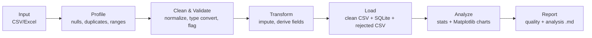

# Student Data ETL Pipeline for Data Cleaning and Analysis

A clean, intermediate-level ETL project for BCA 5th-semester submission. It demonstrates an end-to-end data workflow on messy student records using Python, Pandas, NumPy, Matplotlib, Jupyter Notebook, CSV/Excel input, and CSV/SQLite output. It also includes a simple Streamlit UI to upload data, start the pipeline, and view before/after cleaning results.

## Project overview
The pipeline reads raw student data, profiles quality issues, cleans and validates records, derives analysis fields, loads cleaned outputs, generates charts, and produces Markdown reports. Raw data is never modified.

**Workflow:** `Input -> Profile -> Clean & Validate -> Transform -> Load -> Analyze -> Report`

## Pipeline diagram


## Project structure
```text
student-etl-pipeline/
  data/
    raw/                 # generated/input sample data
    processed/           # students_clean.csv, students_clean_audit.csv, students.db, rejected_records.csv
  outputs/
    charts/              # PNG charts
    reports/             # data_quality_report.md, analysis_summary.md
  src/
    config.py            # paths, schema, ranges, mappings, grade bands
    extract.py           # CSV/Excel extraction and column checks
    profile.py           # pre-clean data quality profiling
    transform.py         # cleaning, validation, imputation, derived fields
    load.py              # save to CSV/SQLite and verify read-back
    analyze.py           # metrics and chart generation
    report.py            # markdown report generation
  tests/
    test_transform.py    # focused pytest tests
  notebooks/
    analysis.ipynb       # walkthrough using src/ modules
  logs/
    pipeline.log         # pipeline logs
  app.py                 # Streamlit UI (upload, start pipeline, before/after view)
  generate_sample_data.py
  main.py                # CLI entry point
  requirements.txt
  README.md
```

## Setup
```bash
cd student-etl-pipeline
python -m venv .venv
# Windows (PowerShell): .venv\Scripts\Activate.ps1
# macOS/Linux: source .venv/bin/activate
pip install -r requirements.txt
```

## How to run (Streamlit UI - demo)
This provides an upload-and-run interface showing **before vs after** cleaning.
```bash
# optional: generate sample dirty data first
python generate_sample_data.py

streamlit run app.py
```
In the UI:
1. Upload a CSV/Excel file (or use the sample `data/raw/students_raw.csv`).
2. Review **Before Pipeline** stats: total rows, missing values, duplicates, out-of-range counts, and a raw preview.
3. Click **Start Pipeline**.
4. View **After Pipeline**: cleaned/rejected counts, missing-marks vs imputed-attendance, cleaned records, rejected records with reasons, charts, and reports (with downloads).

## How to run (CLI)
```bash
python generate_sample_data.py
python main.py --input data/raw/students_raw.csv
```
- CSV and Excel (`.xlsx/.xls`) inputs are supported based on file extension.

## Run tests
```bash
pytest -q
```

## Notebook
```bash
jupyter notebook notebooks/analysis.ipynb
```

## Sample outputs (paths)
- Cleaned data (CSV, no audit flag): `data/processed/students_clean.csv`
- Cleaned data with audit flags (CSV): `data/processed/students_clean_audit.csv`
- Cleaned data (SQLite): `data/processed/students.db` (tables: `students`, `students_audit`)
- Rejected/invalid records: `data/processed/rejected_records.csv`
- Charts: `outputs/charts/`
  - `data_quality_issues.png`
  - `grade_distribution.png`
  - `avg_marks_by_department.png`
  - `attendance_vs_marks.png`
  - `marks_distribution.png`
- Reports: `outputs/reports/`
  - `data_quality_report.md` (before/after counts, fixes, rejections)
  - `analysis_summary.md` (key findings with numbers from actual data)
- Logs: `logs/pipeline.log`

## Design decisions
- **Median imputation for attendance:** Only truly missing or unparseable attendance values (e.g. blank or text) are filled with the **department median**. Parsed values such as `92%` are kept as numeric, while out-of-range attendance is invalidated, flagged, and never imputed. Imputed values are flagged as `attendance_imputed`.
- **Marks are not imputed:** Missing or out-of-range marks are set to `NaN` and flagged (e.g. `missing_marks`, `invalid_marks`). Marks represent actual academic performance; inventing them would fabricate results and distort analysis.
- **Text cleanup:** Names are title-cased, departments/genders are mapped to canonical values, grades are uppercased, attendance `%` suffixes are parsed, and age text such as `19 yrs` is converted to its leading integer.
- **Rejected records are kept:** Exact duplicates, conflicting duplicate Student IDs, and records with out-of-range values are logged to `data/processed/rejected_records.csv` with `rejection_reason` and an `action` column (`row_removed` or `value_invalidated`) so nothing disappears silently.
- **Blank IDs are not duplicate conflicts:** Duplicate-ID checks ignore blank Student IDs; missing IDs are reported separately.
- **Validation over silent fixing:** Values outside valid ranges (marks/attendance 0–100, plausible age) are flagged and invalidated rather than clipped or guessed.
- **Idempotent pipeline:** Running the pipeline twice with the same input produces the same outputs (raw data untouched, processed outputs overwritten deterministically).
- **Centralized config:** Paths, schema, ranges, mappings, and grade bands live in `src/config.py` to avoid magic numbers.

## Limitations and future scope
- **Database connection:** Currently loads to a local SQLite file; can be extended to connect to MySQL/PostgreSQL for shared environments.
- **Scheduling:** Manual CLI/UI execution; can be automated with cron/Task Scheduler for periodic runs.
- **Dashboard:** Includes a simple Streamlit demo UI and static charts; can be extended to a richer interactive dashboard.
- **Richer validation:** Add cross-field rules (e.g. grade vs marks consistency) and configurable rejection policies.
- **Data lineage:** Track per-row transformation history for auditability in larger datasets.
